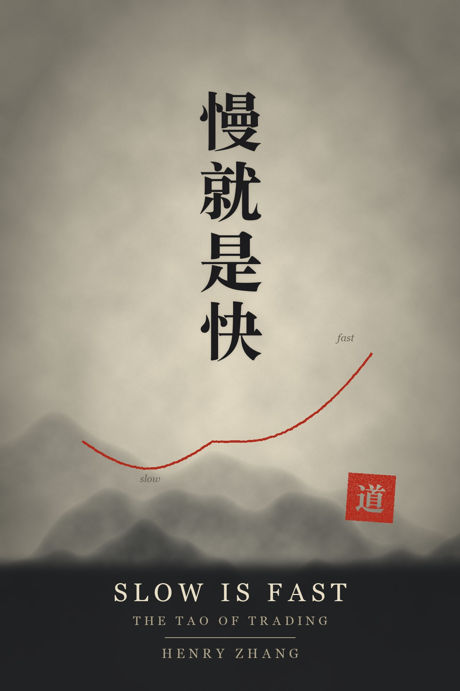

# Slow Is Fast: The Tao of Trading · 慢就是快：交易道德经

**Laozi's eighty-one chapters, in his order and on his subjects, read for the trader: one verse, one lesson, one story.**

> **Status: in progress, written in the open.** The proposal is in [PROPOSAL.md](PROPOSAL.md). Chapters appear here as they are finished, nine at a time, English and Chinese together.
>
> **Progress:** prologue, chapters 1–9 and 64, in English and Chinese (11 of 82 documents; batch 1 of 9, 17 November 2026). Also on the [Henry Zhang Books app](https://apps.apple.com/app/id6792229566), from the prologue to chapter 9.

Two and a half thousand years ago a keeper of archives wrote eighty-one short chapters on how to act without forcing. He wrote about water, which wins by yielding; about the empty bowl, useful because it is empty; about the uncarved block, plain before it is decorated; about the man on tiptoe who cannot stand; and about knowing when to stop, which he said is the end of danger.

He was not writing about markets. Every trader will recognise him anyway. The trade that is forced is ruined. The position that is gripped is lost. The small size, the stop and the defined risk — the soft things — outlast every hard conviction. And the trader who hurries arrives back at the beginning. Fast is slow; slow is fast.

Every chapter has three parts. **The Verse**: the Chinese original and an honest English translation. **The Trader**: a few numbered lines reading it for someone with an order ticket. **The Story**: one story from my own trading and research life — systems that trade on written rules, rules frozen and tested forward for a season, a model that proposes and rules that decide — told as a story, not a lecture.

The companion to [The Art of Options War · 期权兵法](https://github.com/henryzhangpku/art-of-options-war). Sun Tzu tells you when to fight. Laozi tells you when not to.

No forecasts, no signals, no performance claims.

## Read it

| | English | 中文 |
|---|---|---|
| Contents | **[Start here](en/README.md)** | **[从这里开始](zh/README.md)** |
| Prologue | [Before the First Step](en/prologue.md) | [序：始于足下](zh/prologue.md) |
| 1 | [The Rule That Can Be Spoken](en/chapter-01.md) | [道可道](zh/chapter-01.md) |
| 2 | [Long and Short Make Each Other](en/chapter-02.md) | [天下皆知美之为美](zh/chapter-02.md) |
| 3 | [Do Not Display the Desirable](en/chapter-03.md) | [不尚贤](zh/chapter-03.md) |
| 4 | [The Empty Vessel](en/chapter-04.md) | [道冲](zh/chapter-04.md) |
| 5 | [Straw Dogs](en/chapter-05.md) | [天地不仁](zh/chapter-05.md) |
| 6 | [The Valley Spirit](en/chapter-06.md) | [谷神不死](zh/chapter-06.md) |
| 7 | [Heaven Lasts Long](en/chapter-07.md) | [天长地久](zh/chapter-07.md) |
| 8 | [Highest Good Is Like Water](en/chapter-08.md) | [上善若水](zh/chapter-08.md) |
| 9 | [Fill It to the Brim](en/chapter-09.md) | [持而盈之](zh/chapter-09.md) |
| 64 | [The Journey of a Thousand Li](en/chapter-64.md) | [其安易持](zh/chapter-64.md) |

Both editions are written by hand. The Chinese is not a machine translation of the English; it is the same book written twice.

## The two parts

| | | |
|---|---|---|
| **Part I — The Way · 道经** | Chapters 1–37 | What the market is, and what it is not: the rule that can be spoken, the empty vessel, water, the uncarved block, the man on tiptoe, doing nothing and leaving nothing undone. |
| **Part II — The Virtue · 德经** | Chapters 38–81 | How a trader lives with it: knowing when to stop, the soft over the hard, the great vessel finished late, the three treasures, the courage not to dare, and true words that are not beautiful. |

The order is Laozi's, and it is the argument: first see the market plainly, then learn to leave it alone.

## Read one chapter a day

Eighty-one chapters is a little under three months at one a day, about the shortest time in which you can learn anything true about a trading rule. Then read them again.

## A note on what this is

This book is education, not advice. It contains no recommendations for you personally, no signals, no forecasts and no promises. Nothing here is a performance claim; the stories say what was done and why, never what it earned. Trading can lose money, and leverage and options can lose it faster.

The Chinese text of the *Tao Te Ching* is the received Wang Bi text. English translations are the author's own unless marked as James Legge's (1891), which is in the public domain.

## The author

Henry Zhang · 张恒 — [officialhenryzhang.com](https://www.officialhenryzhang.com) · [LinkedIn](https://www.linkedin.com/in/henryzhang99/) · [GitHub](https://github.com/henryzhangpku)

- **Also by the author** — [The Art of Options War · 期权兵法](https://github.com/henryzhangpku/art-of-options-war), Sun Tzu's thirteen chapters read from both ends of a defined-risk options ticket.
- **Also by the author** — [The Options Underwriter · 期权承保](https://github.com/henryzhangpku/options-underwriter), selling options read as running an insurance company.
- **Also by the author** — [The Counted Trade · 算而后战](https://github.com/henryzhangpku/the-counted-trade), the Thirty-Six Stratagems read for the buyer of asymmetric options.
- **On the reading app** — [Henry Zhang Books on the App Store](https://apps.apple.com/app/id6792229566).
- **Notes and letters** — [henryzhang.substack.com](https://henryzhang.substack.com/)

## Licence

[Creative Commons Attribution-NonCommercial-NoDerivatives 4.0 International](LICENSE) (CC BY-NC-ND 4.0).

Free to read, free to share, free to quote with attribution. Not for sale, and not to be published in altered form. See [LICENSE](LICENSE).
